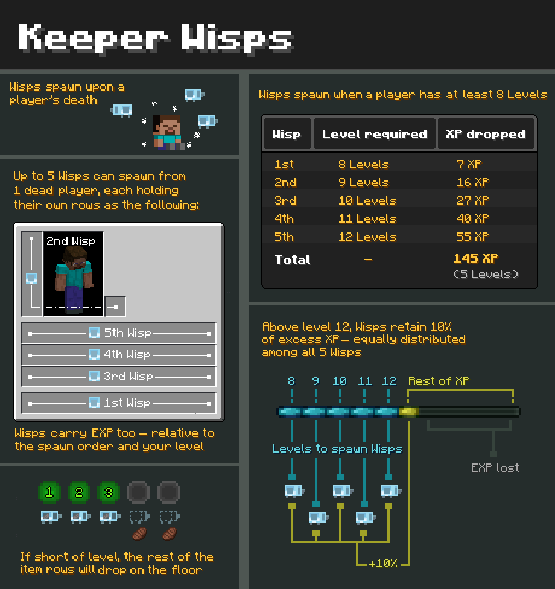
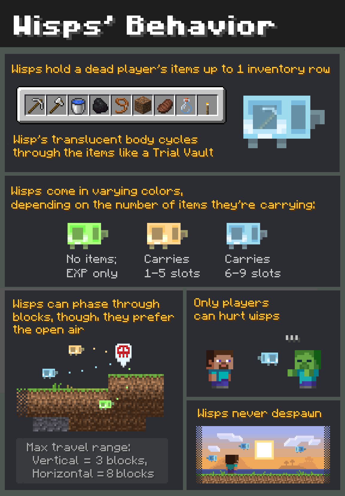
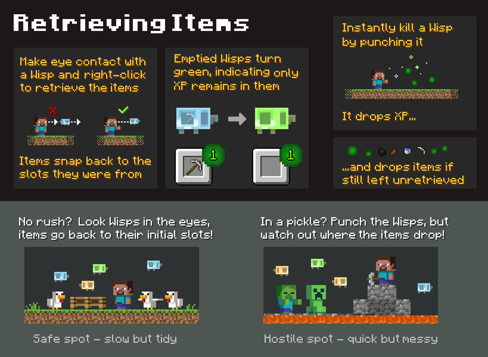

<table style="width: 100%; border-collapse: collapse;">
  <tr>
    <td style="width: 124px; vertical-align: top; text-align: center;">
      

        
      

    </td>
    <td style="vertical-align: top;">
      

        

          
          
          
        

        

          
          
          
        

      

    </td>
  </tr>
</table>

Keeper Wisps — Adds cute creatures that guard your items and experience after you die.

### Showcase
<iframe width="100%" height="480" src="https://www.youtube.com/embed/ijWbbp_b0SQ" title="video player" frameborder="0" allow="accelerometer; autoplay; clipboard-write; encrypted-media; gyroscope; picture-in-picture; web-share" allowfullscreen></iframe>

### Basic Functionality
Wisps spawn where you died if you had at least 8 levels. Below level 8, items drop as usual.

Each Wisp holds one part of the inventory:

| Wisp | Level | Holds                                              |
|------|-------|----------------------------------------------------|
| 1st  | 8     | Hotbar                                             |
| 2nd  | 9     | Armor and offhand (and accessories from other mods)|
| 3rd  | 10    | Bottom row                                         |
| 4th  | 11    | Middle row                                         |
| 5th  | 12    | Top row                                            |

Rows without a Wisp drop on the ground, as in vanilla.

### Experience
Wisps don't take any extra experience. You get back the same amount as in vanilla (7 points per level, up to 100 points). The Wisps hold the first 7, 9, 11, 13 and 15 points of it, and the rest drops as orbs. Above level 12 they also keep 10% of the experience, split evenly between them. Without the mod this part is lost.
 Example at level 20: 55 points in the Wisps, 45 points as orbs, plus 33 points from the 10%.

### Wisps' Behavior
The color depends on how many items a Wisp holds:

| Color  | Holds                       |
|--------|-----------------------------|
| Orange | 1 to 5 slots                |
| Blue   | 6 or more slots             |
| Green  | no items, only experience   |

Wisps never despawn and can only be hurt by players. They can float through blocks, but stay within 3 blocks vertically and 8 blocks horizontally of the place you died.

### Retrieving Items
Look a Wisp in the eyes while it is looking at you. After a second it plays a sound and starts to grow and sparkle. Right-click it, and the items return to the same slots they were taken from. An empty Wisp turns green.
 Punching a Wisp kills it instantly, and it drops all of its items and experience on the ground.

Supports Accessories, Curios and Trinkets.
Required on both client and server. Works only in Survival and is disabled when `keepInventory` is on.

Config file: `config/keeper_wisps.json5`
- `excess_xp_refund` - how much of the experience above the last Wisp's level (12 by default) the Wisps keep, from `0.0` to `1.0` (default `0.1`)
- `first_wisp_level` - level needed for the first Wisp (default `8`)
- `levels_per_wisp` - extra levels needed for each next Wisp (default `1`)

### Want to support mod and authors? Just tell everyone about this mod!

Yeah, you got it right. Just by advertising, you will support the mod and the creators well. The more people will know about this mod, the more downloads it will have, more downloads will give good motivation to authors and increase income from the site (literally free donation). **Remember, advertising must not be intrusive and annoying!**

### What you can do?
- Make a video review / advertisement
- Share it on social media or Discord
- Tell your friends about this mod
- Add it to your modpack or just download and enjoy the game

> Every mention matters — thank you for helping the community grow 🤍

The license terms for this project are defined in the [LICENSE](https://github.com/ZipeStudio/keeper-wisps/blob/master/LICENSE.md) file in this repository. That file always takes precedence over any license shown anywhere else.

### Credits
- Mod by **ZipeStudio** ( me^^ )
- Idea and art by **NaffyZacky** ([Twitter](https://x.com/NaffyZacky/status/2098399751180030000))
- Showcase video by **The13thDrifter** ([YouTube](https://www.youtube.com/@OutcastsStudios))

[**See the original mod repository**](https://github.com/ZipeStudio/keeper-wisps)